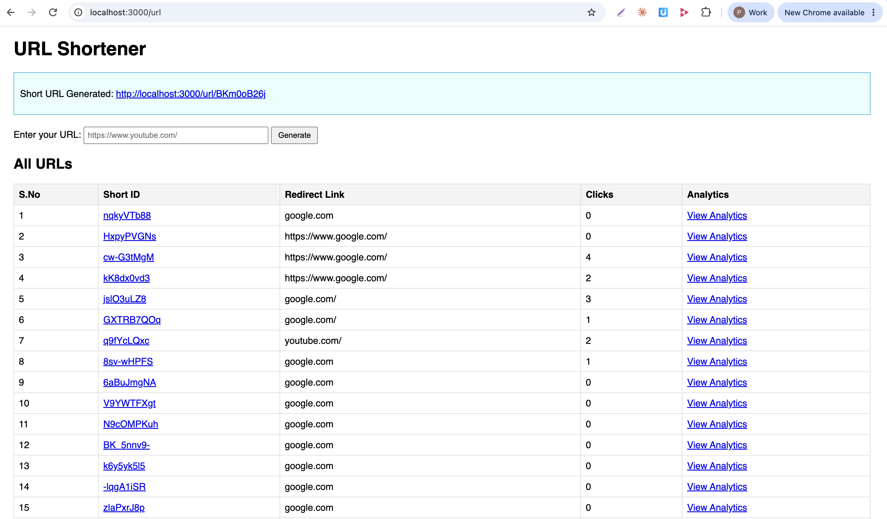
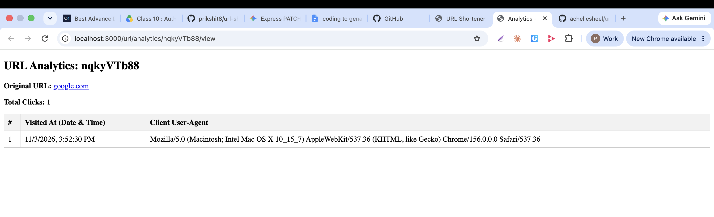

# URL Shortener

A URL shortener built with **Node.js, Express 5, MongoDB (Mongoose) and EJS**. Paste a long link, get a short one, and track how many times it was clicked and from which device.

**Project page:** https://achellesheel.github.io/url-shortner/ (screenshots and write-up only; see [Live demo](#live-demo))

| Home: generate and list URLs | Analytics for one short link |
| --- | --- |
|  |  |

## Functionality

- **Generate a short URL.** The form on `/` posts the link to `POST /url`. A unique 9-character ID is created with `shortid` and stored in MongoDB.
- **Redirect.** `GET /url/:shortId` looks up the ID and redirects to the original link. If the stored link has no `http://` or `https://`, `https://` is added so `google.com` works.
- **Click tracking.** Every redirect adds an entry to the link's `visitHistory` with a timestamp and the visitor's user-agent.
- **Analytics page.** `GET /url/analytics/:shortId/view` shows the original URL, total clicks and a table of every visit (time and browser/device).
- **All URLs table.** The home page lists every link with its short ID, destination, click count and a link to its analytics.
- **Server-rendered UI.** Pages are EJS templates. After you generate a link, the success banner and the updated table render in the same response.
- **JSON-friendly.** `POST /url` accepts JSON as well as form data, so it can be tested with Postman. Missing input returns `400 { "error": "url is required" }`; unknown IDs return `404`.

### Routes

| Method | Path | Purpose |
| --- | --- | --- |
| GET | `/` | Home page: form plus all URLs |
| POST | `/url` | Create a short URL |
| GET | `/url/:shortId` | Redirect and record the visit |
| GET | `/url/analytics/:shortId/view` | Analytics page |

### Work in progress

User sign-up/login (`controllers/user.js`, `routes/user.js`, `middlewares/auth.js`, `service/auth.js`) is started but **not wired into the app yet**. It uses a cookie plus an in-memory session map and still has unfinished code, so don't treat it as working or secure (passwords are not hashed yet).

## Run it locally

Requires Node.js and a local MongoDB on `127.0.0.1:27017`.

```bash
npm install
npm start          # nodemon index.js
```

Open http://localhost:3000. The database name is `short-urls`; change it in `index.js` if needed.

## Live demo

The app needs a running Node server and a MongoDB database, so it cannot run on GitHub Pages, which only serves static files. The Pages site is a static project page with screenshots and this write-up. To host the working app you would need a Node host (Render, Railway, Fly.io) and a hosted database such as MongoDB Atlas.

## Challenging bugs and how we fixed them

| # | Symptom | Cause | Fix |
| --- | --- | --- | --- |
| 1 | Postman `POST localhost:3000/` returned `404 Cannot POST /` | The router is mounted at `/url` (`app.use("/url", urlRoute)`), so nothing handles `POST /` | Send the request to `/url` |
| 2 | `Could not find matching close tag for "<%"` when rendering `home.ejs` | The loop closer was written `<%})>` instead of `<% }) %>` | Close EJS tags with `%>` |
| 3 | `urls is not defined` on render | `res.render("home")` was called without passing data | Query the DB and pass `{ urls }` to the template |
| 4 | `ReferenceError: UrlModel is not defined` | The model was used in `index.js` without being imported | `const UrlModel = require("./models/url")` |
| 5 | `Cannot GET /ejs/<shortId>` | Short links were opened under `/ejs/...`; the redirect route lives at `/url/:shortId` | Link to `/url/<shortId>` from the template |
| 6 | Clicking **Generate** only reloaded the page and added `?redirectURL=...` to the address | A typo, `<formb`, meant the button was not inside a form, so the browser did a plain GET | Fix the tag to `<form method="POST" action="/url">` |
| 7 | Form post answered `400 url is required` | Browsers send `application/x-www-form-urlencoded`, but only `express.json()` was registered, so `req.body` was empty | Add `app.use(express.urlencoded({ extended: false }))` |
| 8 | `SyntaxError: Unexpected token ')'` in `shortened.ejs` | `<%= {shortenedURL } =%>` has braces in the tag and an invalid `=%>` closer | Use `<%= shortenedURL %>` |
| 9 | Analytics page always said "Error rendering analytics page" | The controller called `URL.findOne` (the global `URL` class) instead of the Mongoose model | Use `UrlModel.findOne({ shortId })` |
| 10 | Raw `<%= ... %>` shown in the browser | The `.ejs` file was opened directly instead of through Express | Always browse through `http://localhost:3000` |
| 11 | Two separate pages (`home`, `shortened`) made the user lose the list after generating | `shortened.ejs` didn't have the URL list | Merged into `home.ejs`: the controller renders `home` with the new `id` and the full `urls` list, and the template shows the banner only when `locals.id` exists |
| 12 | Edits didn't show up | Node and EJS cache templates, and the server wasn't restarted | Restart the server; `npm start` uses nodemon |

## Project structure

```
index.js              app setup, middleware, home route
connect.js            MongoDB connection
routes/url.js         /url routes
controllers/url.js    create, redirect, analytics handlers
models/url.js         Mongoose schema (shortId, redirectURL, visitHistory)
views/home.ejs        home page template
docs/                 GitHub Pages site and screenshots
```

## Ideas for next steps

- Finish authentication and hash passwords with bcrypt.
- Validate URLs and reject malformed input.
- Use a custom or collision-safe ID strategy and add expiry for links.
- Deploy the app and database to a Node host.
